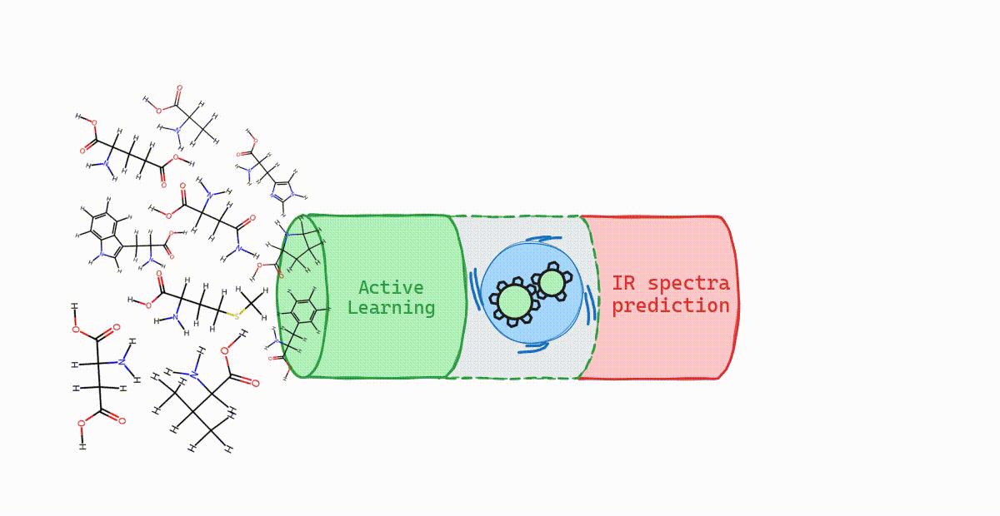

<div style="text-align: center;">
  
</div> 


# Workspace for active learning components

This workspace contains relevant libraries constructed around active learning and vibrational spectroscopy.

The `active_learning` package contains the ALIR paper's active-learning workflow settings. Its current
reference engine is GFNFF rather than the paper's ADF XLYP/DZP level of theory, so quantitative agreement with
the paper should be evaluated separately.

## Citation

If you use this repository, please cite the associated ALIR paper. Bibliographic details will be added here:

```bibtex
@article{10.1021/acs.jctc.6c00756,
    author = {Benedini, Giulio and Hellström, Matti and Visscher, Lucas},
    title = {Flexible On-the-Fly Active Learning for Molecular Infrared Spectra},
    journal = {Journal of Chemical Theory and Computation},
    year = {2026},
    month = {09},
    doi = {10.1021/acs.jctc.6c00756},
    url = {https://doi.org/10.1021/acs.jctc.6c00756},
    publisher={ACS Publications}
}
```

## Repos

- [active_learning](/active_learning/): Automates active learning workflows for atomistic systems, combining data generation, model training, task scheduling, and unified inspection of simulation results.
- [moliterate](/moliterate/): Provides unified access to molecular datasets, combining atomic structures, metadata, and computed properties with modular filtering and collection inspection tools.

## Installation

To run active learning workflows fork/clone this repository and move into the directory [active_learning](/active_learning/).


Installing moliterate package only:
```bash
uv add git+https://github.com/GiulioIlBen/active_learning_for_IR_spectra.git#subdirectory=moliterate
```
